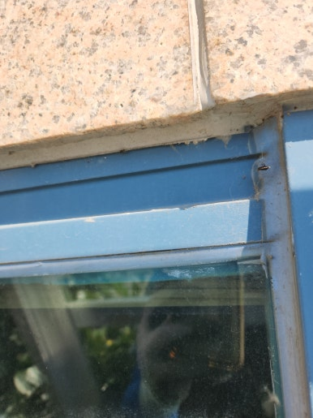
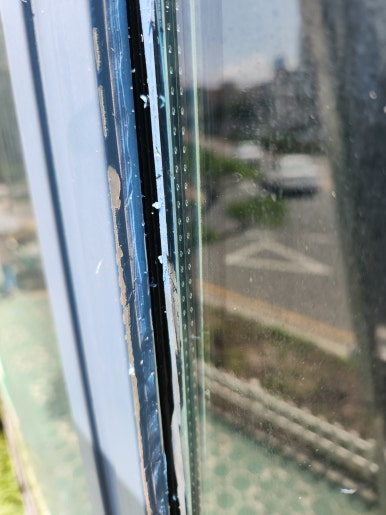
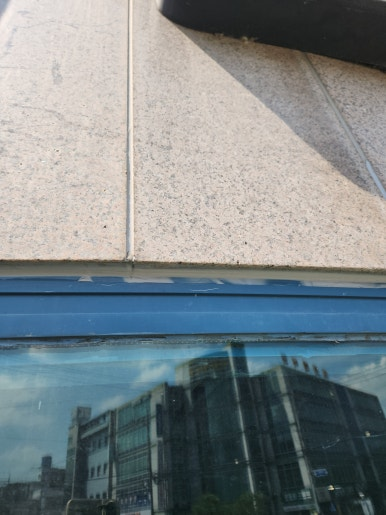
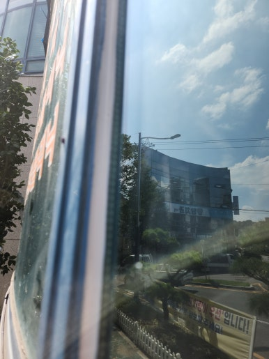

안녕하세요!

수리·보수부터 다양한 시설물 설치 및 철거까지

한 번에 해결해 드리는 **하우스고치미**입니다

오늘은 **경남 김해시 건물 누수 코킹 작업** 사례를 간략하게 소개합니다!

---

---

### 시공 개요

건물은 오랜 시간 햇빛과 비바람에 노출되면서 외벽이나 창틀, 접합 부위의 실리콘이 노후화되고 코킹이 갈라지거나 들뜨기 쉽습니다.

이러한 틈새로 빗물이 유입되면 실내 천장이나 벽면에 물 자국이 생기고 내부 마감재 손상으로 이어질 수 있어, 이번 현장 역시 건물 누수 문제를 예방하고 해결하기 위해 누수 취약 부위 중심의 코킹 보수 작업을 진행하였습니다.

 

 

---

### 시공 전 / 후 비교

**<< 작업 전 >>**

  
  

 
**<< 작업 후 >>**

  
  

 

---

### 주요 작업 내용 및 출장 지역

  
✔️ 누수 의심 부위 및 기존 코킹 상태 점검

  
✔️ 노후 실리콘 및 들뜬 부위 제거

  
✔️ 먼지
