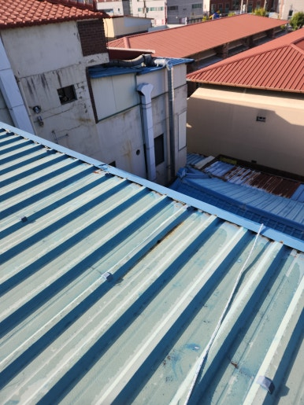
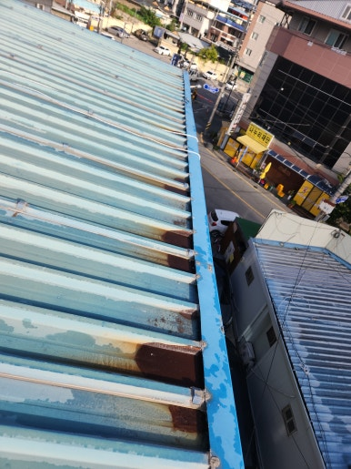
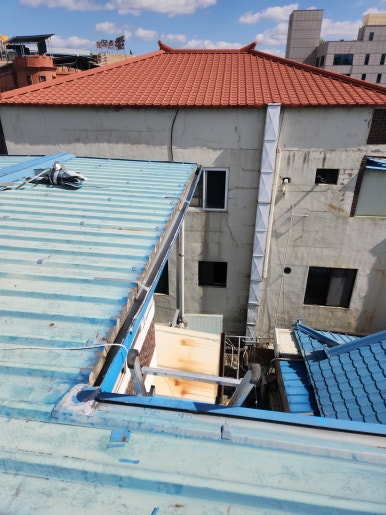
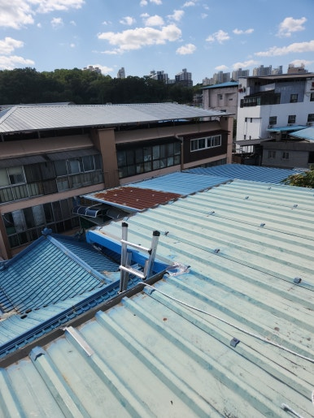

안녕하세요!

수리·보수부터 다양한 시설물 설치 및 철거까지

한 번에 해결해 드리는 **하우스고치미**입니다

오늘은 **경남 합천군 주택 빗물받이 교체 및 보수 작업** 사례를 간략하게 소개합니다!

---

---

### 시공 개요

주택의 빗물받이는 지붕과 처마에서 흘러내리는 빗물을 모아 배수하는 중요한 시설물입니다.

오랜 시간 비바람에 노출되면 노후되어 변형되거나 연결 부위가 벌어지고 고정 부위가 약해질 수 있습니다. 이를 방치하면 빗물이 넘쳐 외벽으로 흘러내려 건물 손상으로 이어질 수 있어, 이번 현장 역시 노후된 빗물받이를 점검하고 필요한 부위를 교체·보수하여 원활한 배수가 이루어지도록 시공하였습니다.

 

 

---

### 시공 전 / 후 비교

**<< 작업 전 >>**

  
  

 
**<< 작업 후 >>**

  
  

 

---

### 주요 작업 내용 및 출장 지역

  
✔️ 기존 빗물받이 노후 및 파손 상태 점검

  
✔️ 손상된 빗물받이 철거 및 부속 정리

  
✔️ 고정면 청소 및 주변 이물질 제거

  
✔️ 새 빗물받이 설치 및 연결부 정비

  
✔️ 고정 상태·배수 흐름 확인 및 현장 정리

 

**출장 가능 지역**: **제주 제외 전국 가능**

*(현장 여건 및 시공 내용에 따라 일정이 조정될 수 있습니다)*

 

---

 

  

    🔍 더 자세한 시공 과정과 세부 사진이 궁금하신가요?
  

  <a href="https://blog.naver.com/bmjldm7116/224461184354" target="_blank" rel="noopener noreferrer" style="display: inline-block; background-color: #03c75a; color: white; font-weight: bold; font-size: 1.05em; padding: 14px 28px; border-radius: 30px; text-decoration: none; box-shadow: 0 4px 6px rgba(0,0,0,0.1); transition: all 0.2s ease;">
    👉 네이버 블로그에서 상세 후기 보기
  </a>

 

---

### 무료 견적 및 상담 안내

전화, 문자, 카카오톡으로 편하게 문의하세요!

실내·실외 보수, 설치, 수리와 관련된 모든 상담을 진행하고 있습니다

**작업 내용이나 현장 사진**을 함께 보내 주시면

더욱 정확하고 빠른 상담이 가능합니다

 

  
무료 견적 및 안내 사항

  
✔️ 전화 · 문자 · 카카오톡 상담 가능

  
✔️ 24시간 365일 언제든 상담 가능

  
✔️ 주말 및 공휴일 정상 상담

 

 

