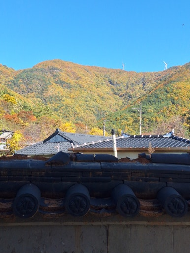
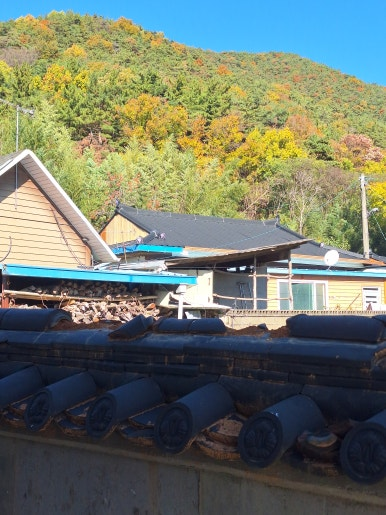
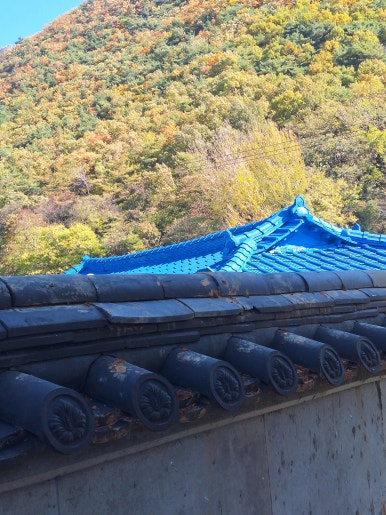
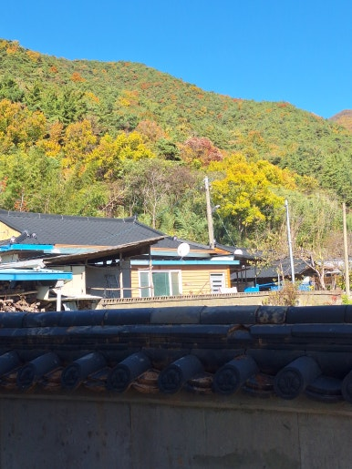

안녕하세요!

수리·보수부터 다양한 시설물 설치 및 철거까지

한 번에 해결해 드리는 **하우스고치미**입니다

오늘은 **경남 창녕군 재실 담장 위 깨진 기와 보수 작업** 사례를 간략하게 소개해 드립니다!

---

---

### 시공 개요

재실 담장 위 기와는 빗물로부터 담장을 보호하고 전통적인 분위기를 살려주는 중요한 시설물입니다.

오랜 시간 비바람과 외부 충격으로 기와가 깨지거나 파손되면 담장 내부 누수 및 추가 손상 등의 문제가 발생할 수 있습니다.

이번 현장에서는 파손된 담장 기와를 확인한 후, 기존 담장과 조화를 이루도록 손상된 기와를 안전하고 깔끔하게 보수하는 데 중점을 두었습니다.

 

 

---

### 시공 전 / 후 비교

**<< 작업 전 >>**

  
  

 
**<< 작업 후 >>**

  
  

 

---

### 주요 작업 내용 및 출장 지역

  
✔️ 현장 점검 (담장 위 기와 파손 상태 및 주변부 확인)

  
✔️ 파손 기와 정리 (깨진 기와 및 잔여물 제거)

  
✔️ 보수 부위 정비 (이물질 제거 및 바탕 정리)

  
✔️ 기와 보수 작업 (기존 담장 형태에 맞춰 기와 교체 및 고정)

  
✔️ 마감 및 점검 (기와 배열 및 고정 상태 최종 확인)

 

**출장 가능 지역**: **대구·경북·경남 전 지역 및 전국 (제주 제외)**

*(현장 여건 및 시공 내용에 따라 일정이 조정될 수 있습니다)*

 

---

 

  

    🔍 더 자세한 시공 과정과 세부 사진이 궁금하신가요?
  

  <a href="https://blog.naver.com/bmjldm7116/224469104242" target="_blank" rel="noopener noreferrer" style="display: inline-block; background-color: #03c75a; color: white; font-weight: bold; font-size: 1.05em; padding: 14px 28px; border-radius: 30px; text-decoration: none; box-shadow: 0 4px 6px rgba(0,0,0,0.1); transition: all 0.2s ease;">
    👉 네이버 블로그에서 상세 후기 보기
  </a>

 

---

### 무료 견적 및 상담 안내

전화, 문자, 카카오톡으로 편하게 문의하세요!

실내·실외 보수, 설치, 수리와 관련된 모든 상담을 진행하고 있습니다

**작업 내용이나 현장 사진**을 함께 보내 주시면

더욱 정확하고 빠른 상담이 가능합니다

 

  
무료 견적 및 안내 사항

  
✔️ 전화 · 문자 · 카카오톡 상담 가능

  
✔️ 24시간 365일 언제든 상담 가능

  
✔️ 주말 및 공휴일 정상 상담

 

 

