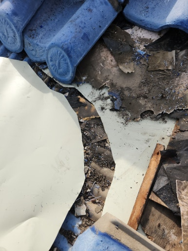
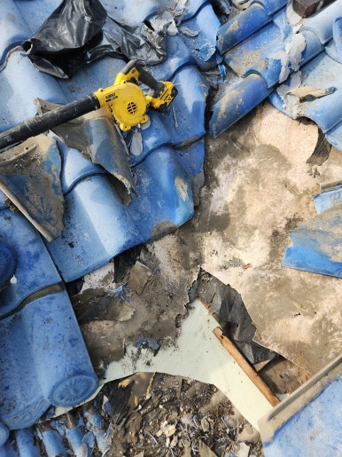
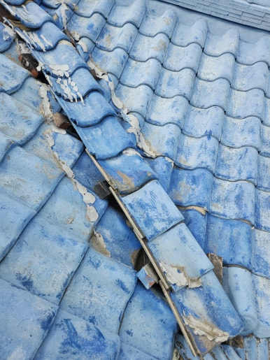
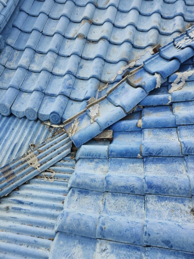

안녕하세요!

수리·보수부터 다양한 시설물 설치 및 철거까지

한 번에 해결해 드리는 **하우스고치미**입니다

오늘은 **경남 양산시 기와지붕 누수 차단 방수 작업** 시공 사례를 간략하게 소개합니다!

---

---

### 시공 개요

오랜 시간 외부 환경에 노출된 기와지붕에서 누수가 발생해 방수 보수가 필요한 상황이었습니다. 

기와 사이 틈새와 연결 부위의 노후 및 손상 상태를 정밀하게 점검하고 정비하여, 빗물 유입을 차단하고 지붕 내구성을 높이는 방수 작업을 진행했습니다.

 

 

---

### 시공 전 / 후 비교

**<< 작업 전 >>**

  
  

 
**<< 작업 후 >>**

  
  

 

---

### 주요 작업 내용 및 소요 시간

  
✔️ 기와지붕 전체 상태 및 누수 의심 부위 점검

  
✔️ 방수 작업 구간의 이물질 및 오염물 정리

  
✔️ 어긋난 기와 틈새와 취약한 연결 부위 보수

  
✔️ 빗물 유입 우려 구간 집중 누수 차단 방수 처리

  
✔️ 방수 마감 상태 및 주변 기와 고정 상태 최종 점검

 

**예상 시공 시간**: **약 1시간 ~ 3시간 소요** 

*(현장 여건 및 지붕 면적·구조에 따라 약간의 차이가 발생할 수 있습니다)*

 

---

 

  

    🔍 더 자세한 시공 과정과 세부 사진이 궁금하신가요?
  

  <a href="https://blog.naver.com/bmjldm7116/224474254602" target="_blank" rel="noopener noreferrer" style="display: inline-block; background-color: #03c75a; color: white; font-weight: bold; font-size: 1.05em; padding: 14px 28px; border-radius: 30px; text-decoration: none; box-shadow: 0 4px 6px rgba(0,0,0,0.1); transition: all 0.2s ease;">
    👉 네이버 블로그에서 상세 후기 보기
  </a>

 

---

### 무료 견적 및 상담 안내

전화, 문자, 카카오톡으로 편하게 문의하세요!

실내·실외 보수, 설치, 수리와 관련된 모든 상담을 진행하고 있습니다

**작업 내용이나 현장 사진**을 함께 보내 주시면

더욱 정확하고 빠른 상담이 가능합니다

 

  
무료 견적 및 안내 사항

  
✔️ 제주 제외 전국 출장 가능

  
✔️ 전화 · 문자 · 카카오톡 상담 가능

  
✔️ 주말 및 공휴일 정상 상담

 

 

