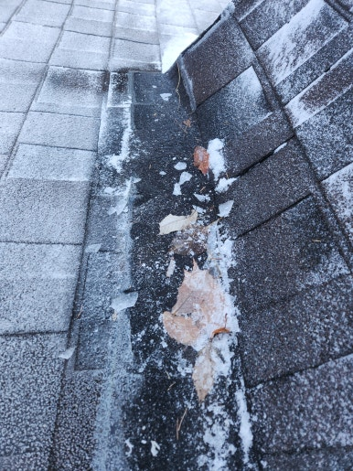
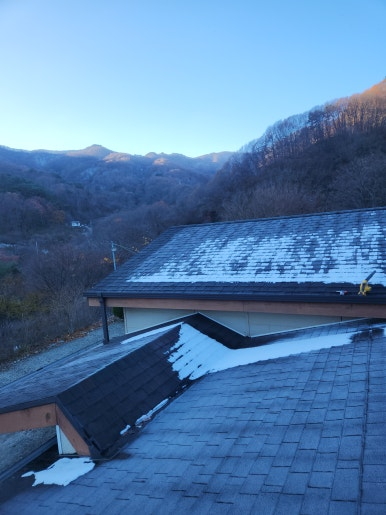
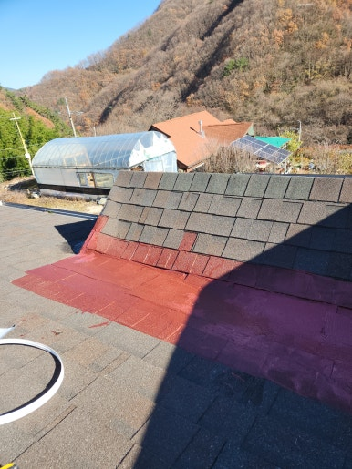
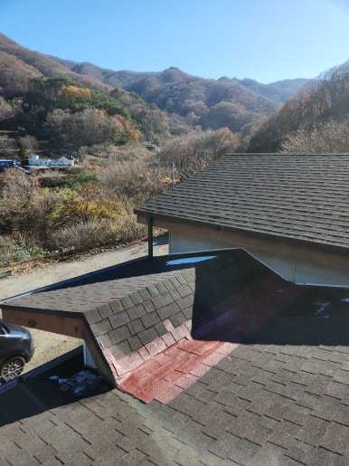

안녕하세요!

수리·보수부터 다양한 시설물 설치 및 철거까지

한 번에 해결해 드리는 **하우스고치미**입니다

오늘은 **경남 산청군 주택 슁글지붕 누수 방수 작업** 시공 사례를 간략하게 소개합니다!

---

---

### 시공 개요

시간이 지나면서 노후화로 인해 슁글의 들뜸과 갈라짐이 발생하고, 방수 성능이 저하되어 누수가 우려되던 경남 산청군 주택 현장이었습니다.

기존 슁글지붕 전체 상태와 빗물 유입 의심 부위를 꼼꼼히 점검한 뒤 먼지와 이물질을 제거하고, 들뜨거나 벌어진 슁글 정비 및 지붕 연결 부위·틈새 방수 보강 작업을 진행하여 누수를 예방했습니다.

 

 

---

### 시공 전 / 후 비교

**<< 작업 전 >>**

  
  

 
**<< 작업 후 >>**

  
  

 

---

### 주요 작업 내용 및 소요 시간

  
✔️ 노후된 슁글지붕 전체 상태 및 누수 의심 부위 현장 점검

  
✔️ 작업 부위 먼지·이물질 제거 및 손상 부분 정리

  
✔️ 들뜨거나 벌어진 슁글 부위 정비 및 보수

  
✔️ 지붕 연결 부위·틈새 취약 구간 방수 처리 및 보강

  
✔️ 방수 처리 상태 및 주변 마감 부위 최종 점검

 

**예상 시공 시간**: **약 5시간 ~ 6시간 소요**

*(작업 범위, 현장 구조 및 기상 환경에 따라 약간의 차이가 발생할 수 있습니다)*

 

---

 

  

    🔍 더 자세한 시공 과정과 세부 사진이 궁금하신가요?
  

  <a href="https://blog.naver.com/bmjldm7116/224491925421" target="_blank" rel="noopener noreferrer" style="display: inline-block; background-color: #03c75a; color: white; font-weight: bold; font-size: 1.05em; padding: 14px 28px; border-radius: 30px; text-decoration: none; box-shadow: 0 4px 6px rgba(0,0,0,0.1); transition: all 0.2s ease;">
    👉 네이버 블로그에서 상세 후기 보기
  </a>

 

---

### 무료 견적 및 상담 안내

전화, 문자, 카카오톡으로 편하게 문의하세요!

실내·실외 보수, 설치, 수리와 관련된 모든 상담을 진행하고 있습니다

**작업 내용이나 현장 사진**을 함께 보내 주시면

더욱 정확하고 빠른 상담이 가능합니다

 

  
무료 견적 및 안내 사항

  
✔️ 제주 제외 전국 출장 가능

  
✔️ 전화 · 문자 · 카카오톡 상담 가능

  
✔️ 주말 및 공휴일 정상 상담

 

 

